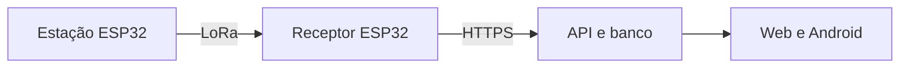

  

# Vitor Matias

**Backend Java · Automação de redes · Sistemas de Informação no IFMG**

Minha experiência em suporte e infraestrutura de telecomunicações inspira meus projetos. Uso Java e Spring Boot para explorar fluxos de atendimento e Python para automatizar tarefas de rede. No IFMG, desenvolvo um TCC sobre apoio à irrigação.

## Projetos em destaque

### ☕ API de chamados de suporte

API REST em **Java 17 e Spring Boot** com criação de chamados, regras de transição e histórico em memória. Os testes com MockMvc cobrem o fluxo HTTP, incluindo validação e transições inválidas.

[Ver API e exemplos](https://github.com/Vitorhrm/spring-docker-app#api-de-chamados) · [Executar com Docker](https://github.com/Vitorhrm/spring-docker-app#executar-com-docker) · 

Experimente uma transição inválida

Crie um chamado e tente ir direto de `OPEN` para `RESOLVED`. A API deve retornar `409`. Em seguida, percorra `OPEN → IN_PROGRESS → RESOLVED` e confira o histórico.

### 🌱 AgroSense · TCC em desenvolvimento

Protótipo de apoio à irrigação com telemetria de uma estação **ESP32** e previsão do tempo por área. A validação das regras de recomendação de irrigação ainda está pendente.

[Ver arquitetura e andamento](https://github.com/Vitorhrm/Agrosense#arquitetura) · [Abrir versão web](https://agrosense-app.vercel.app/agro/)

Como a leitura chega ao aplicativo?

### 🐍 MAC-Fabricante

Automação em **Python** que identifica fabricantes pelo prefixo MAC/OUI em planilhas Excel. O cache local reaproveita resultados de consultas anteriores.

[Testar com a planilha de exemplo](https://github.com/Vitorhrm/MAC-Fabricante#experimentar-com-dados-fict%C3%ADcios)

## Mais projetos

- **Conexões SI** · Mapa interativo para explorar disciplinas e comparar caminhos de carreira em Sistemas de Informação. [Abrir demo](https://vitorhrm.github.io/SADtrab/) · [Ver código](https://github.com/Vitorhrm/SADtrab)
- **Mordix** · Protótipo acadêmico de delivery para Android com React Native, autenticação e catálogo demonstrativo. [Ver projeto](https://github.com/Vitorhrm/Mordix)

## Tecnologias

## Atividade no GitHub

Ver estatísticas e linguagens

  
  

Os cartões são atualizados diariamente com dados públicos do GitHub. O gráfico de linguagens usa o volume de código em cinco projetos selecionados.

<picture>
  <source media="(prefers-color-scheme: dark)" srcset="assets/pacman-contribution-graph-dark.svg">
  
</picture>

## Contato

[LinkedIn](https://www.linkedin.com/in/vitor-hrm-matias/) · [E-mail](mailto:vitorhrm1@hotmail.com) · [Instagram](https://www.instagram.com/vitcs1/)

Ícones de <a href="https://github.com/tandpfun/skill-icons">Skill Icons</a>. Animação de <a href="https://github.com/abozanona/pacman-contribution-graph">Pacman Contribution Graph</a>.
