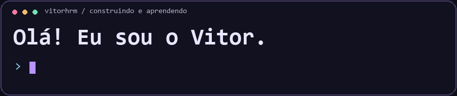
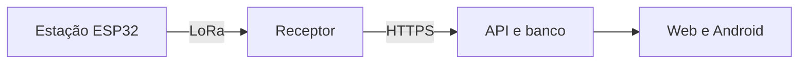
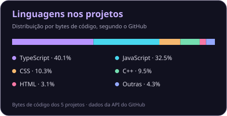

  

# Vitor Matias

**Do suporte de redes ao desenvolvimento de software.**

Estudo Sistemas de Informação no IFMG. Minha experiência em suporte e infraestrutura de telecomunicações orienta o que construo: APIs em Java, automações em Python e um protótipo de irrigação com sensores.

[**Ver projetos**](#projetos) · [Tecnologias](#tecnologias) · [Atividade](#atividade) · [Contato](#contato)

## Projetos

### API de chamados de suporte

Modelei um fluxo de atendimento em **Java 17 e Spring Boot**. Cada mudança de status entra no histórico do chamado, e a API rejeita transições fora da sequência. Os testes com MockMvc cobrem o fluxo HTTP e os casos inválidos.

[**Ver endpoints e exemplos**](https://github.com/Vitorhrm/spring-docker-app#api-de-chamados) · [Executar com Docker](https://github.com/Vitorhrm/spring-docker-app#executar-com-docker)

Testar o que acontece quando um chamado pula uma etapa

1. Crie um chamado com `POST /api/tickets`.
2. Tente mudar de `OPEN` direto para `RESOLVED`. A API responde `409 Conflict`.
3. Passe por `IN_PROGRESS` antes de resolver e consulte o chamado para conferir o histórico em memória.

[Conferir build e testes no GitHub Actions](https://github.com/Vitorhrm/spring-docker-app/actions/workflows/ci.yml)

### AgroSense

> [!NOTE]
> **TCC em desenvolvimento.** A validação das recomendações de irrigação ainda está pendente.

O protótipo reúne medições da estação e previsão do tempo por área. A estação envia as leituras por LoRa para um receptor ESP32, que as encaminha por HTTPS. O aplicativo web e Android exibe a telemetria.

[**Ver arquitetura e andamento**](https://github.com/Vitorhrm/Agrosense) · [Abrir versão web](https://agrosense-app.vercel.app/agro/)

### MAC-Fabricante

Uma automação em **Python** para identificar fabricantes de equipamentos a partir de endereços MAC em planilhas Excel. O script reaproveita as consultas por prefixo OUI com um cache local.

[**Testar com dados fictícios**](https://github.com/Vitorhrm/MAC-Fabricante#experimentar-com-dados-fict%C3%ADcios)

### Outros projetos

- **Conexões SI** reúne disciplinas do IFMG Ouro Branco em um mapa interativo. Você pode comparar carreiras e ver quais matérias se relacionam com cada uma. [Abrir demo](https://vitorhrm.github.io/SADtrab/) · [Ver código](https://github.com/Vitorhrm/SADtrab)
- **Mordix** é um protótipo acadêmico de delivery para Android, com autenticação e fluxo de catálogo e carrinho com dados demonstrativos. [Ver projeto](https://github.com/Vitorhrm/Mordix)

## Tecnologias

- **Backend e testes:** Java, Spring Boot, MockMvc e Docker.
- **Redes e automação:** Python, Linux, ESP32 e LoRa.
- **Web e mobile:** TypeScript, React e React Native.

## Atividade

<picture>
  <source media="(prefers-color-scheme: dark)" srcset="assets/pacman-contribution-graph-dark.svg">
  
</picture>

[Pac-Man no calendário de contribuições](https://github.com/abozanona/pacman-contribution-graph)

Ver estatísticas e linguagens

  
  

Os cartões são atualizados diariamente com dados públicos do GitHub.

## Contato

[LinkedIn](https://www.linkedin.com/in/vitor-hrm-matias/) · [E-mail](mailto:vitorhrm1@hotmail.com) · [Instagram](https://www.instagram.com/vitcs1/)
